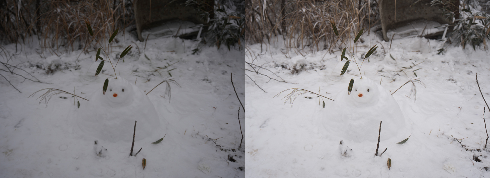
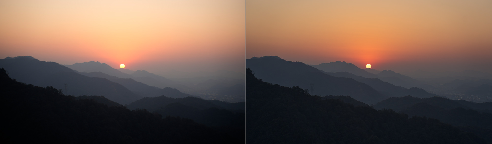
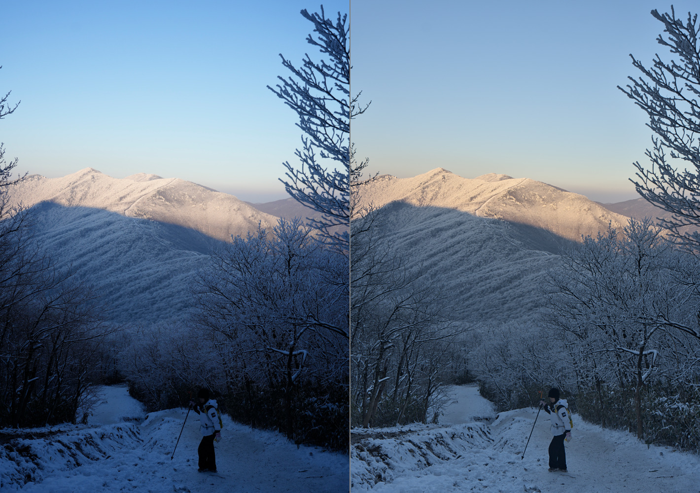

# rawsmith

[](https://github.com/Lewin671/rawsmith/actions/workflows/ci.yml)
[](#licence)

Tell Claude Code or Codex what needs fixing in your RAW photo, and let it develop the picture.

The assistant looks at previews, adjusts the edit and checks detail before
exporting. rawsmith runs locally, leaves your RAW untouched and saves the
edit as a small JSON recipe you can inspect and render again.

rawsmith supports only uncompressed or lossy-compressed Sony A7 IV
(ILCE-7M4) ARW, on macOS and Linux.

## Try it

Install the CLI and the editing skill for both Claude Code and Codex:

```sh
curl -fsSL https://github.com/Lewin671/rawsmith/releases/latest/download/install.sh | sh
```

Then tell your assistant: **“Use rawsmith to edit ~/Pictures/DSC0001.ARW —
the foreground is too dark. Show me a preview before exporting.”**

[Installation options, PATH setup and skill locations](docs/install.md).

## Before and after

Camera JPEG on the left, assistant edit on the right, same framing.



**Snowman — the camera exposed the snow as grey; the edit brings it back to white and keeps its texture.**

<details>
<summary>Two more assistant edits</summary>

**Sunset — a deeper sky and a tighter frame. The camera's own rendering is already good here; this one is a matter of taste.**



**Snow mountain — less blue in the shade and a more readable foreground, with the warm summit light kept.**



</details>

Sony A7 IV photographs, reproduced with permission.
[Exact recipes](docs/recipes) · [Photo permissions and a one-command CC0 example](docs/images/README.md).

## One edit, from request to export

“Keep the sunset warm, bring out the mountain layers and crop some of the
empty sky.”

Using `sunset.ARW` for the source photo, these commands reproduce
[the published recipe](docs/recipes/sunset.json).

```sh
rawsmith inspect sunset.ARW
```
The assistant reads the camera settings, as-shot white balance and sensor exposure.

```sh
rawsmith auto sunset.ARW -o sunset-start.jpg --size 1400
```
It opens the starting preview and reads `decisions`, using output clipping
(`stats.clipped_highlights_pct`, `stats.channel_clipped_pct_rgb`),
full-active-area `sensor_clipped_pct` and `stats.crushed_shadows_pct` to guide
detail checks. Zero pure-white clipping does not prove correct highlight colour.

```sh
rawsmith edit sunset.ARW --reset \
  --set exposure=-0.8 --set highlights=-35 --set shadows=30 \
  --set whites=-10 --set blacks=-10 --set contrast=5 \
  --set clarity=10 --set dehaze=12 --set vibrance=25 \
  --set crop.top=0.1 --set crop.bottom=0.98 \
  -o sunset-edit.jpg --size 1400
```
It lowers exposure, lifts shadows, adds dehaze and trims the sky, then opens `rawsmith compare sunset.ARW -o sunset-compare.jpg` to compare the upright camera JPEG with the current edit using the edit's framing.

```sh
rawsmith render sunset.ARW --region 0.4,0.4,0.6,0.6 -o sunset-detail.jpg
```
It checks full-resolution detail for noise, sharpening halos and lost texture.

```sh
rawsmith render sunset.ARW -o sunset-final.jpg
```
It exports the full-resolution JPEG; `.png` would give 16-bit output.
Both declare sRGB (ICC in JPEG, a standard sRGB chunk in PNG).
`compare` uses the embedded JPEG's colour declaration, falling back to RAW
EXIF; declared Adobe RGB camera previews are converted to sRGB and tagged.
A single `--panel camera` exports this upright camera rendering alone.
Unknown or unverified camera colour produces a warning and an untagged row.
Outputs are replaced; RAWs never. Use a new output name to keep a version;
the report's `output_replaced` field signals replacement.

The published recipe records the resulting edit:

```json
{
  "blacks": -10.0,
  "clarity": 10.0,
  "contrast": 5.0,
  "crop": { "bottom": 0.98, "top": 0.1 },
  "dehaze": 12.0,
  "exposure": -0.8,
  "highlights": -35.0,
  "rawsmith": "0.1.0",
  "shadows": 30.0,
  "vibrance": 25.0,
  "whites": -10.0
}
```

[Editing skill](skill/rawsmith/SKILL.md) · [CLI and recipe reference](docs/cli.md).

## Why it is built this way

- **Images and numbers together.** Render reports include tone percentiles,
  clipping, colour cast and a 3×3 brightness grid. An assistant can look
  at the picture and check what its last adjustment did.
- **Previews match resized exports.** Previews develop at full resolution,
  including noise reduction, tone and sharpening, then area-resize the
  finished sRGB pixels. Check 100% detail for artefacts hidden by resizing.
  The [v0.1.0 benchmark](docs/benchmark.md) used the earlier approximate
  preview path; its preview timings do not describe this path.
- **An edit is a recipe.** `render --set` tries
  settings; `edit` saves them. The same rawsmith binary, RAW and recipe produce
  the same file, bit for bit ([exact terms](docs/cli.md)).
  Separate recipes keep separate versions.
- **A discoverable CLI.** Successful subcommands return JSON on stdout;
  errors return JSON on stderr with exit status 1 and empty stdout. `--help` and
  `--version` print plain text. `rawsmith schema` gives parameter ranges
  and meanings, including `vignette` and graduated filters (`gradients`).
  RAW, recipe and output paths must be valid UTF-8; invalid paths return a
  `params` error before any file is written, with the path named lossily.
  Reports identify the recipe file, declared output colour space and RAW
  compression. Validation and staging failures leave recipes and outputs
  unchanged; paired saves roll back ordinary commit failures. See the
  [CLI reference](docs/cli.md) for crash and rollback limits.
- **The developing engine is here.** Rust modules implement RAW decoding,
  demosaicing, highlight reconstruction, lens corrections, colour, tone,
  local contrast, dehaze, noise reduction and sharpening.
  [See the stages](docs/pipeline.md).

## Results

Against the macOS RAW converter, `auto` recorded 15 wins with Claude
and 12 wins, 3 ties and no losses with GPT-6 Luna on the published development set.

Correction: All 15 private-set camera JPEGs were Adobe RGB but were shown
unconverted as sRGB in the published `camera` comparisons. This made the
camera rendering look duller and less saturated than it is. The
`neutral`/`auto`/`ai` vs `camera` rows therefore overstate rawsmith's advantage
and are withdrawn pending a rerun. Historical counts are retained.
Comparisons against `system`, `auto` vs `neutral` and `ai` vs `auto` are
unaffected, as are the three sRGB CC0 samples.
Counts in the published blind comparisons are wins – losses – ties per photo.

| Comparison | Claude | GPT-6 Luna |
|---|---|---|
| `auto` vs camera JPEG **(withdrawn)** | 15 – 0 – 0 | 12 – 0 – 3 |
| `auto` vs macOS RAW converter | 15 – 0 – 0 | 12 – 0 – 3 |
| Default recipe vs camera JPEG **(withdrawn)** | 10 – 0 – 5 | 5 – 0 – 10 |
| Assistant-edited vs `auto` | 12 – 1 – 2 | 6 – 0 – 9 |

This is a development set: 15 photos from one camera and one photographer,
used while tuning the engine and `auto`. The two LLM judges saw each pair
without labels, in both orders. These are model preferences, not a panel
of photographers or a ranking of RAW developers. The edited recipes were
made by Claude, which shares a vendor with one judge.

Both judges called all identical pairs a tie. They rejected spoiled
controls in 40 of 40 and 36 of 40 cases; verdicts survived swapping image
order in 92% and 75% of pairs, respectively. The second judge's order
sensitivity contributes to its higher tie count.

Decoder samples matched LibRaw on all 18 test files. Synthetic tests also
check demosaicing, highlight reconstruction, colour, noise reduction and
sharpening against known answers. [Full measurements, method and limits](docs/benchmark.md).

## Limits

Only Sony A7 IV ARW, uncompressed or lossy-compressed, is supported.
Lossless-compressed ARW is not supported yet. Other cameras need a colour
matrix and a test file; see [CONTRIBUTING.md](CONTRIBUTING.md).

Local edits are graduated filters. There are no brushes, subject masks,
spot removal or dust removal. Output is sRGB JPEG or 16-bit PNG, without
camera metadata.
JPEG embeds a compact ICC v2 sRGB profile; PNG uses its standard sRGB chunk.
Preview clipping statistics can differ slightly from the full-resolution
export, as small clipped areas average away in small previews.

## Privacy

rawsmith develops photos locally without network access. Images produced
by `render`, `edit`, `auto` and `compare` contain no EXIF, GPS or serial numbers.
`extract-jpeg` copies the camera JPEG unchanged, including its metadata;
check or remove it before sharing.
It also leaves stored pixels unrotated and reports `raw_orientation`,
`needs_rotation` and `rotation_degrees_clockwise` for upright comparison.
Check whether your viewer already applies orientation before rotating.

If a cloud-hosted assistant views your previews, those images are sent to
its provider, like any other image you show it.

## Licence

Choose [Apache License 2.0](LICENSE-APACHE) or [MIT](LICENSE-MIT).
Contributions use the same terms. Photographs have
[separate permissions](docs/images/README.md).
The embedded sRGB profile is CC0; see its
[source and licence](assets/profiles/README.md).

The camera colour matrix is sensor characterisation data published in
Adobe's DNG Converter and reproduced by open-source RAW software. The
one-command demo photo is a CC0 sample from [raw.pixls.us](https://raw.pixls.us).
