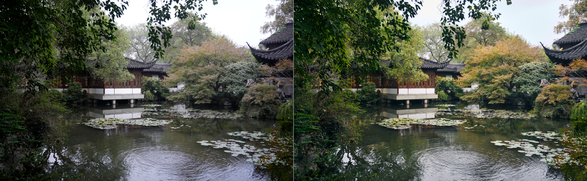
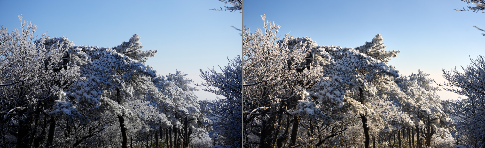
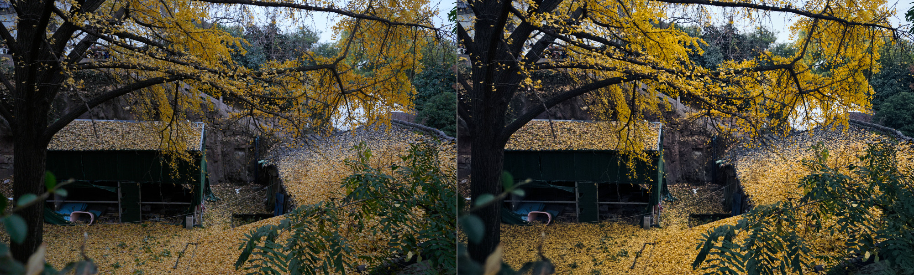

# rawsmith

[](https://github.com/Lewin671/rawsmith/actions/workflows/ci.yml)
[](#licence)

Hand Claude Code or Codex a RAW photo and get back a finished picture.

The assistant works like a photo editor: it looks at the photo, decides
what the picture should be, crops, sets the light and the colour, compares
its work with the camera's JPEG and checks detail before exporting. You do
not have to describe a look — say what you want if you know, or just ask
it to edit the photo. rawsmith runs locally, leaves your RAW untouched and
saves the edit as a small JSON recipe you can inspect and render again.

The treatment follows the subject and light: fog keeps its softness,
night keeps its darkness, and colour supports the scene. The assistant
compares its trials and delivers the best one; a stronger effect is kept
only when it makes a better photograph.

rawsmith supports Sony A7 IV (ILCE-7M4) Bayer ARW on macOS and Linux.

| Sensor encoding | Supported modes |
|---|---|
| Uncompressed | Full frame and APS-C |
| Lossy-compressed | Full frame and APS-C |
| Lossless-compressed | Full-frame L and APS-C M (14-bit Bayer) |
| Reduced-size lossless YCbCr | Unsupported: full-frame M/S and APS-C S |

[Format details and sample verification](docs/formats.md).

## Try it

Install the CLI and the editing skill for both Claude Code and Codex:

```sh
curl -fsSL https://github.com/Lewin671/rawsmith/releases/latest/download/install.sh | sh
```

Then tell your assistant: **“Use rawsmith to edit ~/Pictures/DSC0001.ARW.”**
Add a direction if you have one — *“keep it dark and quiet”*, *“the
foreground is too dark”* — and it takes precedence.

[Installation options, PATH setup and skill locations](docs/install.md).

## Before and after

Camera JPEG on the left, assistant edit on the right. In each case the
request was only *“edit this photo”*; the camera panel is cropped to the
edit's framing.



*A garden pond under an overcast sky. The assistant opened the dark trees
on the left, made the greens deeper and let the autumn maple and the
pavilion's timber carry the warmth.*

<details>
<summary>More assistant edits</summary>

*Rime on pines — the camera rendered the frost blue-grey; the edit makes
it white against a deeper sky.*



*Ginkgo at dusk (ISO 4000) — the surroundings go cool and quiet so the
gold leaves carry the picture.*



</details>

Sony A7 IV photographs, reproduced with permission; rendered by 0.2.0.
[Exact recipes](docs/recipes) · [Photo permissions and a one-command CC0 example](docs/images/README.md).

## One edit, from request to export

These are the steps behind the pond picture above
([its recipe](docs/recipes/pond.json)), with `pond.ARW` standing for the
source photo.

```sh
rawsmith inspect pond.ARW
rawsmith auto pond.ARW -o start.jpg --size 1400
rawsmith compare pond.ARW -o compare.jpg
```
The assistant reads how the sensor was exposed (the sky is blown and
cannot be recovered), takes `auto`'s measured starting point and looks at
it beside the camera's JPEG. Then it decides the picture: *a quiet
pavilion over the pond on an overcast day, deep greens with a touch of
autumn.*

```sh
rawsmith edit pond.ARW \
  --set crop.top=0.1 --set crop.left=0.06 --set crop.bottom=0.97 \
  --set shadows=45 --set highlights=-55 --set contrast=12 --set blacks=-12 \
  --set 'curve=[[0.2,0.17],[0.5,0.53],[0.8,0.83]]' \
  --set 'gradients=[{"from":[0,0.5],"to":[0.3,0.5],"exposure":-0.3}]' \
  --set temperature=5900 --set tint=28 --set vibrance=25 \
  --set hsl.green.hue=12 --set hsl.green.luminance=-8 \
  --set hsl.orange.saturation=30 --set hsl.red.saturation=20 \
  --set grade.shadows.hue=190 --set grade.shadows.saturation=18 \
  --set grade.highlights.hue=50 --set grade.highlights.saturation=14 \
  --set vignette=-25 \
  -o edit.jpg --size 1400
```
Composition first (a strip of blown sky and dark tree goes), then light
(open the shadows, hold the left edge with a graduated filter), then
colour (greens toward a deeper teal, the maple's orange and red brought
forward, cool shadows under warm highlights). In practice this takes a
few rounds, each one rendered and looked at; the published recipe has a
few more settings than shown here.
This palette suits this pond photo; it is not a default look for other scenes.

```sh
rawsmith compare pond.ARW -o compare.jpg
rawsmith render pond.ARW --region 0.4,0.3,0.6,0.5 -o detail.jpg
rawsmith render pond.ARW -o final.jpg
```
It checks the edit against the camera's JPEG in the same framing, inspects
100% detail for noise, halos and coloured edges, and exports at full
resolution (`.png` gives 16-bit output).

The edit is a small JSON file next to the RAW, holding only what differs
from the defaults.

[Editing skill](skill/rawsmith/SKILL.md) · [CLI and recipe reference](docs/cli.md).

## Why it is built this way

- **Images and numbers together.** Render reports include tone percentiles,
  clipping, colour cast and a 3×3 brightness grid. An assistant can look
  at the picture and check what its last adjustment did.
- **Previews match resized exports.** Previews develop at full resolution,
  including noise reduction, tone and sharpening, then area-resize the
  finished sRGB pixels. Check 100% detail for artefacts hidden by resizing.
- **Rounds are quick.** The developed frame of a photo is kept in the
  temporary directory between commands, so changing tone, colour, crop or
  masks does not develop the RAW again, and the picture is the same bytes
  either way ([details](docs/cli.md#reusing-the-developed-frame)).
- **It says what an edit cost.** `compare` lists what each version gave up
  against the camera's rendering: a lifted black point, flatter tones, new
  clipping, a colour gone weak. An assistant chasing an idea tends not to
  see those.
- **An edit is a recipe.** `render --set` tries
  settings; `edit` saves them. The same rawsmith binary, RAW and recipe produce
  the same file, bit for bit ([exact terms](docs/cli.md)).
  Separate recipes keep separate edits. Recipes store only what differs
  from the defaults, so a release that changes the defaults changes how
  older recipes render; reports say so in `recipe_compatibility`.
- **A discoverable CLI.** Successful subcommands return JSON on stdout;
  errors return JSON on stderr with exit status 1 and empty stdout. `--help` and
  `--version` print plain text. `rawsmith schema` gives parameter ranges
  and meanings, including `vignette` graduated filters (`gradients`) and local linear/radial/luminance masks (`masks`).
  RAW, recipe and output paths must be valid UTF-8; invalid paths return a
  `params` error before any file is written, with the path named lossily.
  Reports identify the recipe file, declared output colour space and RAW
  compression. Validation and staging failures leave recipes and outputs
  unchanged; paired saves roll back ordinary commit failures. See the
  [CLI reference](docs/cli.md) for crash and rollback limits.
- **The developing engine is here.** Rust modules implement RAW decoding,
  demosaicing, highlight reconstruction, lens corrections, colour, tone,
  local contrast, dehaze, automatic neutral-edge colour protection, optional additional defringing, noise reduction and sharpening.
  [See the stages](docs/pipeline.md).

## Results

Ten Sony A7 IV photos kept out of development were edited by an assistant
following the 0.2.0 editing skill, with no direction beyond *“edit these photos”*, and
judged blind against the camera's JPEG, the macOS RAW converter and
rawsmith's own automatic and default renderings. Counts are wins – losses
– ties per photo.

| Comparison | All 10 | The 6 never used in development |
|---|---|---|
| Assistant edit vs camera JPEG | 10 – 0 – 0 | 6 – 0 – 0 |
| Assistant edit vs macOS RAW converter | 10 – 0 – 0 | 6 – 0 – 0 |
| Assistant edit vs `auto` | 8 – 0 – 2 | 5 – 0 – 1 |
| `auto` vs camera JPEG | 6 – 0 – 4 | 2 – 0 – 4 |
| `auto` vs macOS RAW converter | 7 – 2 – 1 | 4 – 1 – 1 |
| Default recipe vs camera JPEG | 4 – 3 – 3 | 2 – 2 – 2 |

Read this with its limits. Four of the ten photos were looked at while
0.2.0's `auto` and skill were being tuned, so the right-hand column is the
cleaner evidence, and six photos is a small sample. The judge was Codex
`gpt-6.1-sol` at low effort, shown both image orders with spoiled controls
and identical pairs; the editor was the same model, which may favour its
own edits. Camera JPEGs were converted from Adobe RGB to sRGB.

The editing guidance and judge criteria were revised after 0.4.0;
these historical results do not validate those revisions.

In that run, the developing engine alone was roughly level with
the camera, `auto` was at least as good as the camera, and the clear gain
came from the assistant's judgement — cropping, deciding what should be
bright, and choosing a palette.

On the reference Intel i7-10700 (8 cores / 16 threads, macOS), the first
render of a 33 MP ISO 100 file takes 2.90 s for a 1400 px default preview,
4.65 s for `auto` with a preview, and 3.50 s for a native JPEG export; an
ISO 4000 file takes 4.25 / 6.22 / 4.88 s. Every later render of the same
photo in an editing session reuses its developed frame: 1.29 s for a
preview and 1.86–1.90 s for a native export at either ISO, with peak RSS
of 0.97–1.19 GB instead of 1.91–2.30 GB. A typical edited recipe (curve,
colour, masks) adds about 0.8 s. These are medians of three serial runs
with allocation diagnostics enabled. Reused renders are byte-identical to
fresh ones; previews still develop at native resolution and resize last.
[Stages, method and what was tried](docs/performance.md).

Decoder samples matched LibRaw on the original 18 test files and two
additional CC0 lossless Bayer files (55,050,240/55,050,240 samples).
Synthetic tests also check demosaicing, highlight reconstruction, colour, noise reduction and
sharpening against known answers. [Full measurements, method and limits](docs/benchmark.md).

## Limits

Only Sony A7 IV Bayer ARW is supported. Lossless full-frame M/S and APS-C
S store reduced-size YCbCr rather than Bayer and return `unsupported`.
Other cameras need a colour matrix and a test file; see
[CONTRIBUTING.md](CONTRIBUTING.md).

Local edits support four legacy graduated filters and eight linear/radial
masks with optional luminance selection. There are no brushes, semantic subject
masks, local white balance, spot removal or dust removal.

Known rendering weaknesses: with the sun in frame, pulling `highlights`
far down shows the blown core as a disc with a visible edge where the
camera shows a soft glow; fine branches against a blown sky can keep some
pastel specks at 100% even with `defringe`; at high ISO, texture weaker
than the noise is smoothed away with it.

Output is sRGB JPEG or 16-bit PNG, without
camera metadata.
JPEG embeds a compact ICC v2 sRGB profile; PNG uses its standard sRGB chunk.
Preview clipping statistics can differ slightly from the full-resolution
export, as small clipped areas average away in small previews.

## Privacy

rawsmith develops photos locally without network access. Images produced
by `render`, `edit`, `auto` and `compare` contain no EXIF, GPS or serial numbers.
`extract-jpeg` copies the camera JPEG unchanged, including its metadata;
check or remove it before sharing.
It also leaves stored pixels unrotated and reports `raw_orientation`,
`needs_rotation` and `rotation_degrees_clockwise` for upright comparison.
Check whether your viewer already applies orientation before rotating.

If a cloud-hosted assistant views your previews, those images are sent to
its provider, like any other image you show it.

## Licence

Choose [Apache License 2.0](LICENSE-APACHE) or [MIT](LICENSE-MIT).
Contributions use the same terms. Photographs have
[separate permissions](docs/images/README.md).
The embedded sRGB profile is CC0; see its
[source and licence](assets/profiles/README.md).

The camera colour matrix is sensor characterisation data published in
Adobe's DNG Converter and reproduced by open-source RAW software. The
one-command demo photo is a CC0 sample from [raw.pixls.us](https://raw.pixls.us).
