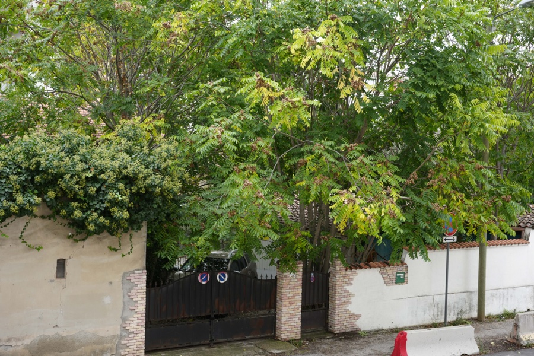
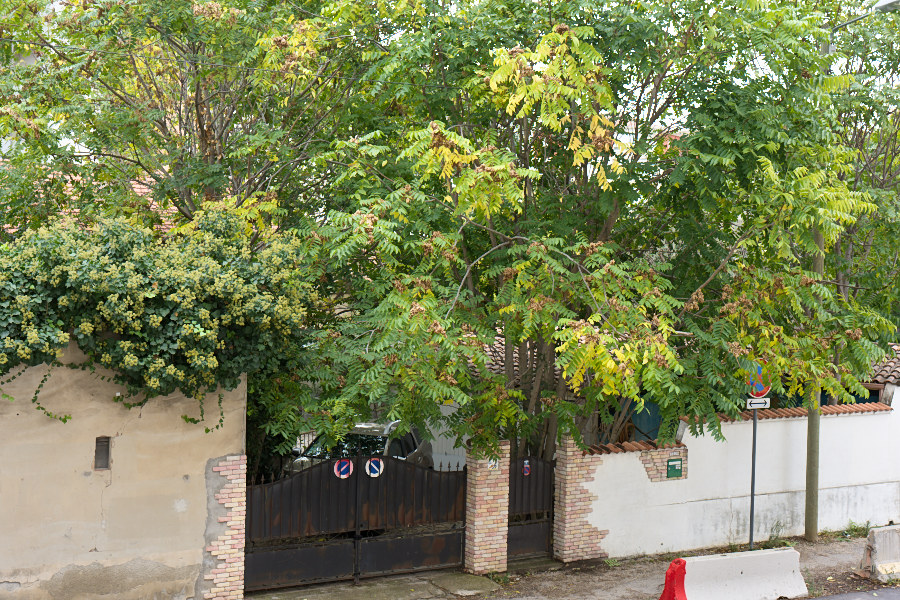

# Documentation photographs

- `demo-camera.jpg` and `demo-rawsmith.jpg`: a CC0 Sony A7 IV sample
  from [raw.pixls.us](https://raw.pixls.us), rendered by rawsmith 0.1.0.
- `pond-comparison.jpg`, `rime-comparison.jpg` and
  `ginkgo-comparison.jpg`: user-provided Sony A7 IV photographs,
  reproduced with permission for this repository's documentation. These
  photographs are not CC0 and are not covered by the code's MIT/Apache-2.0
  licences; no permission for other reuse is granted here.

Comparison images are resized JPEGs without EXIF metadata. No source RAW
files are included. The left image is the camera's embedded JPEG; the
right image is developed with rawsmith using the recipes in
[`../recipes`](../recipes). Both panels use the recipe's crop and rotation.
The camera panels are converted from the camera's Adobe RGB to sRGB by
`compare`, which tags the combined JPEG. No text is drawn on the images.

Each was produced with the owner's private RAW (not included here) and the
recipe of the same name:

```sh
rawsmith compare "$RAW" --panel camera --panel recipe:docs/recipes/NAME.json -o docs/images/NAME-comparison.jpg --size 1000
```

All three were edited by an assistant following the skill, asked only to
edit the photo, and rendered with rawsmith 0.2.0.

## One-command auto example (CC0 sample)

| Camera JPEG | `rawsmith auto` |
|---|---|
|  |  |

A CC0 sample from [raw.pixls.us](https://raw.pixls.us) (Sony A7 IV), developed with one command by rawsmith 0.1.0.
